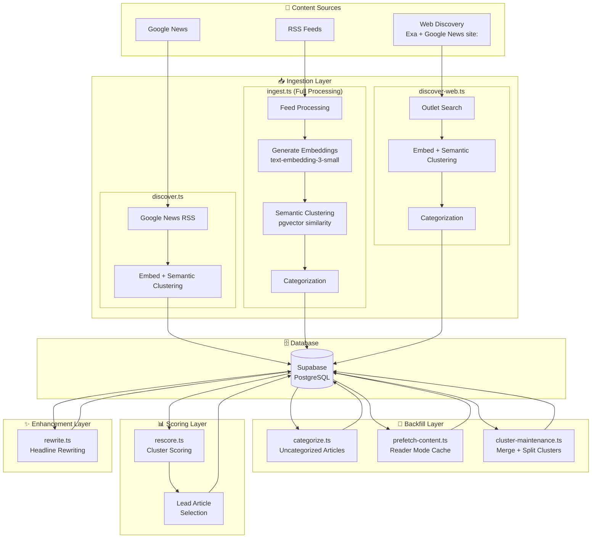
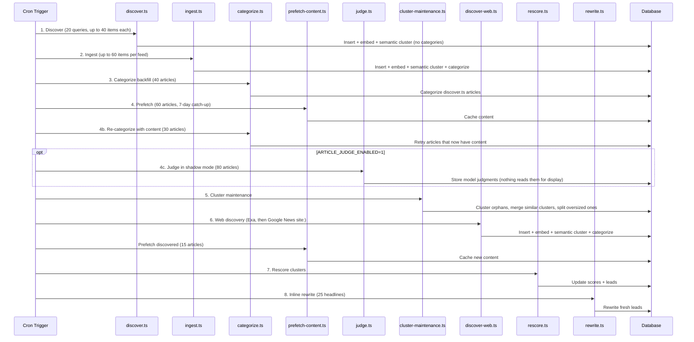
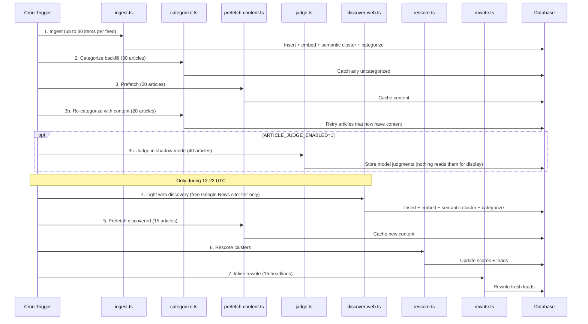
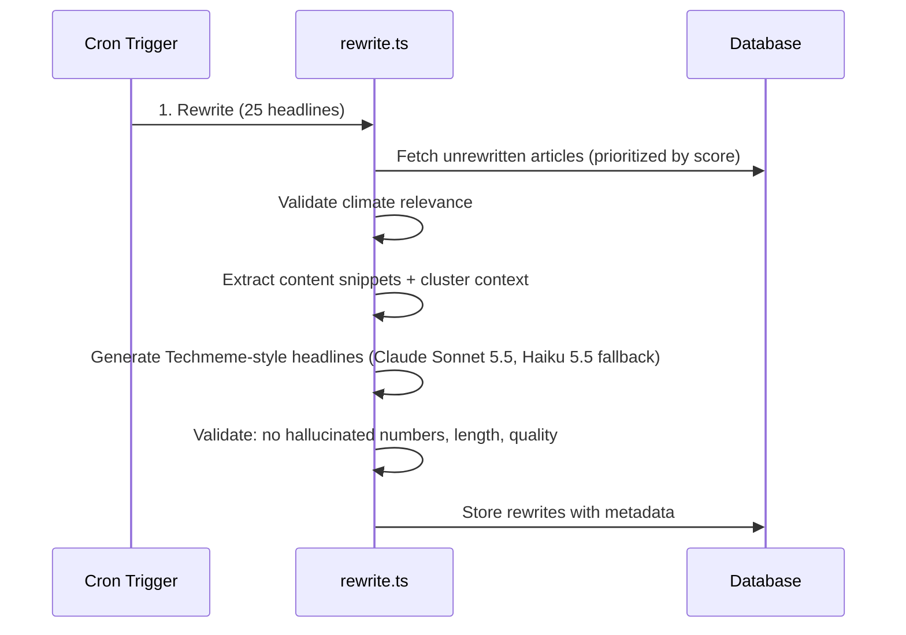
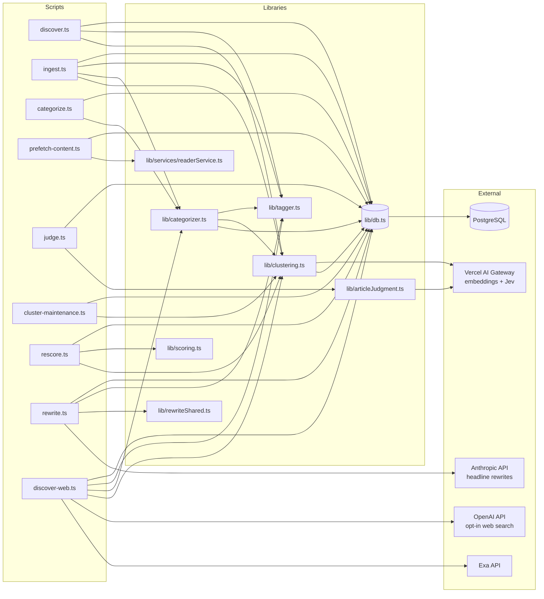
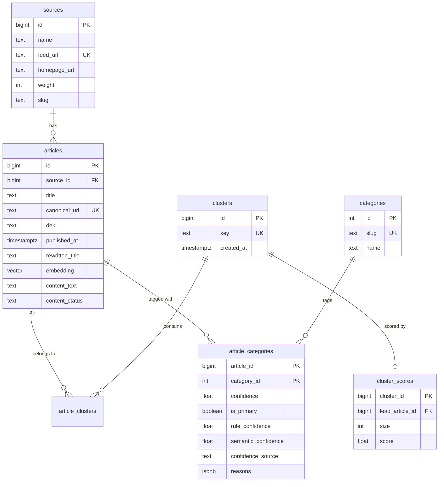
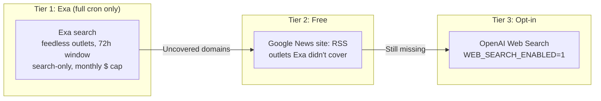

# Climate River

Minimal, fast climate news river. Next.js (App Router) + Tailwind + Postgres (Supabase).

Created by [Dylan Wahbe](https://dylanwahbe.com).

## Pipeline Architecture

Climate River uses a multi-stage data pipeline orchestrated by six Vercel cron jobs: three move content through the pipeline at different frequencies and intensities, and three handle maintenance.

### Cron Schedule Overview

```mermaid
gantt
    title Daily Pipeline Cron Schedule (UTC)
    dateFormat HH
    axisFormat %H:00

    section Full Cron
    Full (5min)    :f1, 01, 1h
    Full (5min)    :f2, 10, 1h
    Full (5min)    :f3, 20, 1h

    section Refresh Cron
    Refresh (2min) :r1, 00, 1h
    Refresh (2min) :r2, 04, 1h
    Refresh (2min) :r3, 12, 1h
    Refresh (2min) :r4, 16, 1h
    Refresh (2min) :r5, 18, 1h
    Refresh (2min) :r6, 22, 1h

    section Rewrite Cron
    Rewrite (1min) :w1, 00, 1h
    Rewrite (1min) :w2, 03, 1h
    Rewrite (1min) :w3, 07, 1h
    Rewrite (1min) :w4, 11, 1h
    Rewrite (1min) :w5, 12, 1h
    Rewrite (1min) :w6, 13, 1h
    Rewrite (1min) :w7, 14, 1h
    Rewrite (1min) :w8, 15, 1h
    Rewrite (1min) :w9, 16, 1h
    Rewrite (1min) :w10, 17, 1h
    Rewrite (1min) :w11, 18, 1h
    Rewrite (1min) :w12, 19, 1h
    Rewrite (1min) :w13, 20, 1h
    Rewrite (1min) :w14, 21, 1h
    Rewrite (1min) :w15, 22, 1h
    Rewrite (1min) :w16, 23, 1h
```



| Cron        | Schedule                                      | Timeout | Purpose                                                              |
| ----------- | --------------------------------------------- | ------- | -------------------------------------------------------------------- |
| **Full**    | 01:00, 10:00, 20:00 UTC                       | 5 min   | Complete pipeline: discovery, cluster maintenance, paid outlet sweep |
| **Refresh** | 00:00, 04:00, 12:00, 16:00, 18:00, 22:00 UTC  | 2 min   | Lighter pass: ingest, free web discovery, rescore                    |
| **Rewrite** | 00:00, 03:00, 07:00, 11:00-23:00 hourly (16×) | 1 min   | Sweeps headlines the inline rewrite passes didn't reach              |
| **Cleanup** | 02:00 UTC daily                               | 1 min   | Deletes articles past the 45-day retention window                    |
| **Health**  | 08:30 UTC daily                               | 1 min   | Checks pipeline metrics against thresholds, alerts on a breach       |
| **Feeds**   | Mondays 06:00 UTC                             | 5 min   | Upgrades productive discovery-only hosts to real RSS sources         |

### Pipeline Flow



### Full Cron Pipeline

The full cron (`/api/cron/full`) runs the complete pipeline:



Rescore runs after cluster maintenance and web discovery so that new and merged clusters are scored in the same run. Cluster maintenance, web discovery and the inline rewrite are skipped when the run is close to its time budget.

### Refresh Cron Pipeline

The refresh cron (`/api/cron/refresh`) runs a lighter pipeline more frequently:



### Rewrite Cron Pipeline

The full and refresh crons rewrite fresh leads inline. The rewrite cron (`/api/cron/rewrite`) sweeps whatever they didn't reach:



### Script Details

| Script                   | Purpose                   | AI Model                               | Clustering              | Categorization | Key Features                                                  |
| ------------------------ | ------------------------- | -------------------------------------- | ----------------------- | -------------- | ------------------------------------------------------------- |
| `discover.ts`            | Google News RSS           | `text-embedding-3-small`               | **Semantic** (pgvector) | ❌             | 20 climate queries, relevance filtering, publisher URL lookup |
| `ingest.ts`              | RSS feed processing       | `text-embedding-3-small`               | **Semantic** (pgvector) | ✅ Inline      | Full pipeline: dedup, embeddings, clustering, categorization  |
| `discover-web.ts`        | Outlet discovery sweep    | Exa search + GN `site:`, embeddings    | **Semantic** (pgvector) | ✅ Inline      | Curated outlets without a live feed; OpenAI opt-in            |
| `categorize.ts`          | Backfill categorization   | Hybrid rules + embeddings              | —                       | ✅             | Catches uncategorized articles (e.g., from discover.ts)       |
| `prefetch-content.ts`    | Reader mode cache         | —                                      | —                       | —              | Content extraction, paywall detection                         |
| `judge.ts`               | Shadow judgments (opt-in) | Jev via AI Gateway                     | —                       | —              | Relevance, category, language, article type; not displayed    |
| `cluster-maintenance.ts` | Cluster repair            | —                                      | **Semantic** (pgvector) | —              | Clusters orphans, merges similar clusters, splits oversized   |
| `rescore.ts`             | Cluster scoring           | —                                      | —                       | —              | Velocity, coverage, authority, lead selection                 |
| `rewrite.ts`             | Headline enhancement      | Claude Sonnet 5.5 (Haiku 5.5 fallback) | —                       | —              | Techmeme-style, fact validation, no hallucinated numbers      |

**Clustering:**

Every ingestion path (`ingest.ts`, `discover.ts`, `discover-web.ts`) embeds the article and calls `assignArticleToCluster` in `lib/clustering.ts`, which uses pgvector cosine similarity against each cluster's stored centroid to group articles about the same story, even with different wording. `cluster-maintenance.ts` then clusters stragglers, merges similar clusters and splits oversized ones.

### Function Call Graph

```mermaid
flowchart TB
    subgraph Cron["🕐 Cron Entry Points"]
        FULL["/api/cron/full"]
        REFRESH["/api/cron/refresh"]
        REWRITE_CRON["/api/cron/rewrite"]
    end

    subgraph CronLib["lib/cron.ts"]
        safeRun["safeRun()"]
        authorized["authorized()"]
    end

    FULL --> authorized
    REFRESH --> authorized
    REWRITE_CRON --> authorized
    FULL --> safeRun
    REFRESH --> safeRun
    REWRITE_CRON --> safeRun

    subgraph DiscoverScript["scripts/discover.ts"]
        disc_run["run()"]
        disc_ingestQuery["ingestQuery()"]
        disc_insertArticle["insertArticle()"]

        disc_run --> disc_ingestQuery
        disc_ingestQuery --> disc_insertArticle
    end

    subgraph IngestScript["scripts/ingest.ts"]
        ing_run["run()"]
        ing_ingestFromFeed["ingestFromFeed()"]
        ing_insertArticle["insertArticle()"]

        ing_run --> ing_ingestFromFeed
        ing_ingestFromFeed --> ing_insertArticle
    end

    subgraph WebDiscoverScript["scripts/discover-web.ts"]
        web_run["run()"]
        web_exa["runExaOutletSegment()"]
        web_gn["runGoogleNewsSiteOutletSegment()"]
        web_outletDiscovery["runOutletDiscoverySegment()"]
        web_exaSearch["lib/exa.ts exaSearch()"]
        web_openai["callOpenAIWebSearch()"]
        web_collect["insertCollectedCandidates()"]
        web_tryInsert["tryInsertDiscoveredArticle()"]
        web_insertArticle["insertWebDiscoveredArticle()"]

        web_run --> web_exa
        web_run --> web_gn
        web_run --> web_outletDiscovery
        web_exa --> web_exaSearch
        web_outletDiscovery --> web_openai
        web_exa --> web_collect
        web_gn --> web_collect
        web_outletDiscovery --> web_collect
        web_collect --> web_tryInsert
        web_tryInsert --> web_insertArticle
    end

    subgraph ClusteringLib["lib/clustering.ts"]
        clust_embed["generateEmbedding()"]
        clust_assign["assignArticleToCluster()"]
        clust_find["findBestCluster()"]

        clust_assign --> clust_find
    end

    subgraph MaintenanceScript["scripts/cluster-maintenance.ts"]
        maint_run["run()"]
    end

    subgraph CategorizeScript["scripts/categorize.ts"]
        cat_run["run()"]
    end

    subgraph JudgeScript["scripts/judge.ts"]
        judge_run["run()"]
    end

    subgraph JudgmentLib["lib/articleJudgment.ts"]
        judge_article["judgeArticle()"]
    end

    subgraph RewriteScript["scripts/rewrite.ts"]
        rew_run["run()"]
        rew_batch["batch()"]
        rew_processOne["processOne()"]
        rew_generate["generateHeadline()"]

        rew_run --> rew_batch
        rew_batch --> rew_processOne
        rew_processOne --> rew_generate
    end

    subgraph RewriteLib["lib/rewriteShared.ts"]
        rewLib_inputs["buildRewriteInputs()"]
        rewLib_validate["validateHeadline()"]
    end

    subgraph RescoreScript["scripts/rescore.ts"]
        res_run["run()"]
    end

    subgraph PrefetchScript["scripts/prefetch-content.ts"]
        pre_run["run()"]
    end

    subgraph CategorizerLib["lib/categorizer.ts"]
        catLib_store["categorizeAndStoreArticle()"]
        catLib_hybrid["categorizeArticleHybrid()"]
        catLib_storeCategories["storeArticleCategories()"]
        catLib_articleEmbed["generateArticleEmbedding()"]
        catLib_catEmbed["getCategoryEmbedding()"]

        catLib_store --> catLib_hybrid
        catLib_store --> catLib_storeCategories
        catLib_hybrid --> catLib_articleEmbed
        catLib_hybrid --> catLib_catEmbed
    end

    subgraph TaggerLib["lib/tagger.ts"]
        tag_isClimate["isClimateRelevant()"]
        tag_categorize["categorizeArticle()"]
    end

    subgraph ReaderLib["lib/services/readerService.ts"]
        reader_prefetch["prefetchArticles()"]
        reader_getContent["getArticleContent()"]
        reader_fetch["fetchArticleContent()"]

        reader_prefetch --> reader_getContent
        reader_getContent --> reader_fetch
    end

    subgraph DbLib["lib/db.ts"]
        db_query["query()"]
        db_endPool["endPool()"]
    end

    %% Script to lib connections
    safeRun -.-> disc_run
    safeRun -.-> ing_run
    safeRun -.-> cat_run
    safeRun -.-> pre_run
    safeRun -.-> judge_run
    safeRun -.-> maint_run
    safeRun -.-> res_run
    safeRun -.-> rew_run
    safeRun -.-> web_run

    disc_ingestQuery --> tag_isClimate
    disc_insertArticle --> clust_embed
    disc_ingestQuery --> clust_assign
    ing_ingestFromFeed --> tag_isClimate
    ing_insertArticle --> clust_embed
    ing_ingestFromFeed --> clust_assign
    ing_ingestFromFeed --> catLib_store
    web_tryInsert --> tag_isClimate
    web_insertArticle --> clust_embed
    web_tryInsert --> clust_assign
    web_tryInsert --> catLib_store
    maint_run --> clust_find
    cat_run --> catLib_store
    catLib_hybrid --> tag_categorize
    judge_run --> judge_article
    rew_processOne --> tag_isClimate
    rew_processOne --> rewLib_inputs
    rew_processOne --> rewLib_validate
    pre_run --> reader_prefetch

    %% All scripts use db
    disc_run --> db_query
    ing_run --> db_query
    cat_run --> db_query
    judge_run --> db_query
    maint_run --> db_query
    res_run --> db_query
    rew_run --> db_query
    web_run --> db_query
    pre_run --> db_query
    catLib_store --> db_query
```



### Shared Library Dependencies



### Database Schema (Core Tables)



### Scoring Algorithm

Cluster scores determine homepage ranking. The weights and decay constants live in `lib/scoring.ts`, shared by `rescore.ts` (which stores the decay-free part) and the `get_river_clusters` database function (which applies freshness at read time):

```
base_score = (0.35 × velocity) + (0.15 × coverage) + (0.15 × authority) + (0.05 × pool_strength) + (up to 0.03 × novelty)
score      = (base_score + 0.30 × freshness) × age_damping × singleton_discount
```

Each term is normalized to 0–1. Where:

- **Freshness**: Exponential decay with a 12-hour half-life on the cluster's newest article, recomputed at read time so ranking stays current between rescore runs
- **Velocity**: Trust-weighted distinct outlets publishing in the last 24 hours (each contributes its weight ÷ 10, log-scaled)
- **Coverage**: Source diversity + total weighted coverage + cluster size (log-scaled and capped)
- **Authority**: Weight of the best source covering the story (source weights are integers 1-10, see `config/sourceTiers.ts`)
- **Pool Strength**: Aggregate article quality within the cluster
- **Novelty**: Small boost for clusters semantically far from the current top stories
- **Age damping**: 168-hour half-life on the cluster's _first_ article, floored at 0.7, so a weeks-old story can't hold the top slot on a trickle of updates
- **Singleton discount**: ×0.85 for clusters with fewer than two strong sources

The homepage Top view also applies a gate: a cluster appears only with at least two strong sources (weight ≥ 4) or a lead from a weight ≥ 8 source. Latest and category views are ungated.

**Lead Article Selection:**

Each cluster's lead is the article with the highest `(0.80 × editorial_quality) + (0.20 × freshness)`, where article freshness decays with a 6-hour half-life. Articles with an aggregator URL, a low-value host or a suspect date are only chosen when the cluster has nothing else.

Editorial quality includes:

- Source weight (1-10)
- Author presence (+0.25)
- Dek length ≥120 chars (+0.10)
- Aggregator URL penalty (-0.50)
- Low-value host penalty: PR wires, stock-tip sites, content farms (-0.60)

### Web Discovery Tiers

The `discover-web.ts` script sweeps the curated outlets that have no live RSS feed (resolved from `sources` at run time) in tiers:



---

## License

Copyright © 2026 Dylan Wahbe.

Climate River is open source software licensed under the [Apache License 2.0](./LICENSE). See [`LICENSE`](./LICENSE) and [`NOTICE`](./NOTICE) for full terms.
